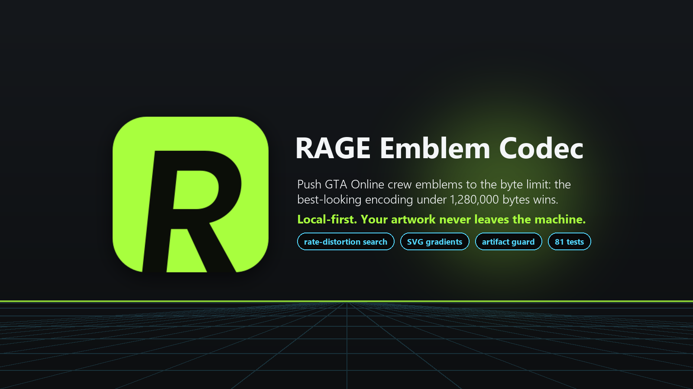
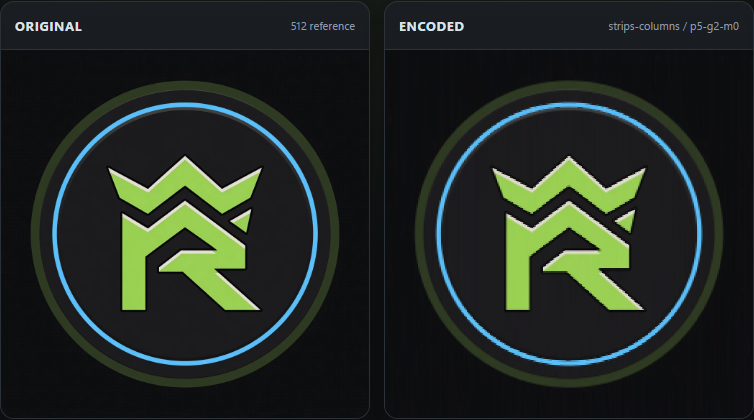
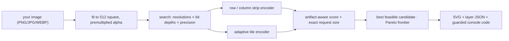

<div align="center">



[](https://github.com/SenjuWoo/RAGE-Emblem-Codec/actions/workflows/ci.yml)
[](https://github.com/SenjuWoo/RAGE-Emblem-Codec/releases)
[](package.json)
[](package.json)
[](LICENSE)

**[Live demo](https://senjuwoo.github.io/RAGE-Emblem-Codec/)** · **[Run it](#run)** · **[Tour](#a-two-minute-tour)** · **[Search modes](#search-modes)** · **[Benchmarks](#benchmarks)** · **[How it works](#how-it-works)** · **[Changelog](CHANGELOG.md)**

</div>

Rockstar's crew emblem editor does not take a PNG. Artwork has to be described as
SVG gradients plus emblem-layer JSON, and the save request has a practical ceiling
of about **1,280,000 bytes**. RAGE Emblem Codec treats that as a small
rate-distortion problem: it generates many Rockstar-compatible encodings of your
image, scores each one for how it actually looks, and keeps the best one that fits.

```text
maximize perceptual quality
subject to  request size  <=  1,280,000 bytes
```

It grew out of [Emblem Helper 1.1 by Flashback-GTA](https://github.com/search?q=Emblem+Helper+Flashback-GTA),
which proved the strip-to-gradient trick. This project keeps that compatibility path
and replaces most of the rest.

## What you get

- **Automatic maximum-quality search under a hard byte ceiling.** Fast and Deep modes, a Pareto frontier, and a winner that is always feasible.
- **Better strips.** An upgraded row / column strip encoder with real gradient fitting, and segmented-alpha strips: transparent gaps are left out instead of being spanned by full-height or full-width paths.
- **No background needles.** Transparency Guard plus soft-edge padding remove Social Club background needles without wrecking antialiasing.
- **Sharp logos and text.** An adaptive rectangular tile encoder for flat versus detailed regions, hard-edge protection, and premultiplied-alpha resampling (no coloured halos around transparency).
- **Scoring that sees artifacts.** Edge fidelity, transparent leakage and directional streak detection, so a scanline-melted candidate cannot win on a slightly higher scalar score.
- **A safe export.** The generated Social Club console code measures the real request and aborts without sending if it is over budget.
- **Local-first.** Your artwork never needs to leave your machine. No runtime dependencies for the portable web app.
- **Tested.** 81 automated tests (codec, artifact regressions, search, preview scaling, version and UI guards, packaging). A Tauri 2 desktop scaffold is included; no prebuilt Windows `.exe` is shipped.


<p align="center">
  
</p>

<p align="center"><sub>Real captures from <code>tools/capture-hero.mjs</code> against the local server. The sample emblem is original documentation art, not a Rockstar or Take-Two asset.</sub></p>

## Run

Node.js 20 or newer.

```powershell
git clone https://github.com/SenjuWoo/RAGE-Emblem-Codec.git
cd RAGE-Emblem-Codec
npm install
npm run serve
```

On Windows you can also double-click `start.bat`. Or skip the install and use the
[live demo](https://senjuwoo.github.io/RAGE-Emblem-Codec/), which runs the same
static build in your browser.

Open [http://127.0.0.1:4173](http://127.0.0.1:4173). Set `PORT` to use a different port.

Do not open `index.html` as a `file://` page. The worker and the sample image need the local server.

A portable ZIP with `SHA256SUMS.txt` is attached to each
[release](https://github.com/SenjuWoo/RAGE-Emblem-Codec/releases).

## A two-minute tour

1. Import an image (PNG, JPG or WEBP, kept at native resolution up to 2048 px), or press **Load sample emblem**.
2. Leave the budget at `1280000` and press **Auto Max Quality**.
3. Compare **Original** and **Encoded**, read the winning candidate's quality, payload, layers, encoder and artifact guard, and check the frontier.
4. Press **Generate Rockstar code**, then **Copy console code**. **Download SVG** and **Download report** save the result locally.

Keyboard: `Ctrl+O` import · `Ctrl+Enter` search · `Esc` cancel.

### Export to Rockstar

1. Generate console code in the app.
2. Open the Social Club crew emblem editor while logged in.
3. Paste the snippet into the browser console.
4. The snippet reads the live editor token and hash, measures the real JSON body, and **aborts without sending** if it is over budget.

### Preview vs console / in-game

Original is the 512×512 letterboxed reference the codec scores against. Encoded is the same 512×512 SVG the console snippet uploads; the card only *displays* it (a viewBox is added in the page, not in the Rockstar payload).

v0.1.5 hardened both directions of the old scanline failure. Transparent gaps are still split into compact alpha-supported runs, but complex visible runs now have a separate structural-error ceiling: if a long row or column stops behaving like a real gradient, it is split into smaller local pieces instead of being smeared across the subject. Approximate gradient-to-gradient merging is disabled, and Auto demotes high-artifact candidates before comparing scalar quality.

Advanced → **Transparency guard** controls how aggressively sub-visible alpha noise is discarded (Auto = 8/255), while **Soft-edge padding** keeps one neighbouring sample by default so antialiased silhouettes still fade naturally. **Strip direction** remains available for diagnosis, but Auto no longer applies a blanket penalty to either orientation: rows and columns can both win when they remain structurally clean.

## Search modes

| Mode | Behavior |
| --- | --- |
| **Fast** | High-value strip/tile space. Stops once an artifact-aware feasible candidate reaches `99.95 / 100`. |
| **Deep** | No quality target. Continues until an exact reconstruction, exhaustion, or the candidate cap. |
| **Auto precision** | Tries 5, then 4, then 3 decimal geometry. Transform scales keep at least 5 decimals so 512-strip emblems stay opaque. |

## Benchmarks

Deterministic synthetic artwork (256 px), not a claim about every photo. Quality is the v0.1.5 artifact-aware proxy (`100` = exact under that metric), so values are not directly comparable with pre-v0.1.5 benchmark scores.

| Budget | Legacy-style | RAGE | Quality | Payload |
| ---: | --- | --- | ---: | ---: |
| 1,280,000 B | 98.449 @ 536,060 B | **99.954 @ 532,424 B** | **+1.505** | **−3,636 B** |
| 120,000 B | 50.406 @ 116,928 B | **52.060 @ 80,608 B** | **+1.654** | **−36,320 B** |

At the real ceiling, spending leftover bytes is intentional. The objective is maximum quality under the cap, not the smallest file. Full JSON: [`docs/benchmark-results.md`](docs/benchmark-results.md). CI runs both budgets on every push.


```powershell
npm run benchmark
```

Override with `SIZE`, `BUDGET`, or `QUALITY_TARGET`.

## Commands

| Need | Command |
| --- | --- |
| Local web app on `127.0.0.1:4173` | `npm run serve` (or `start.bat`) |
| Codec, artifact and UI tests | `npm test` |
| Version lock + syntax check | `npm run check` |
| Static frontend into `dist/` | `npm run build` |
| Static server smoke test | `npm run smoke` |
| Legacy vs RAGE benchmark | `npm run benchmark` |
| Portable ZIP + `SHA256SUMS.txt` | `npm run package` |
| Optional Tauri 2 desktop build | `npm run tauri -- build` |


### Optional desktop app

The source is laid out for Tauri 2. On a Windows machine with the Rust stable toolchain and the MSVC build tools:

```powershell
npm install
npm run build
npm run tauri -- build
```

The bundle target is NSIS only. This repository does **not** ship a prebuilt `.exe`.

## How it works



```text
src/codec/     pure encoder / search / payload math
src/worker.js  off-thread optimizer
src/main.js    browser / Tauri UI
tests/         deterministic Node tests
tools/         static server, builder, benchmark, release zip, screenshot capture
src-tauri/     optional Tauri 2 shell (NSIS)
```

- **The payload size is computed, not guessed.** The estimator equals the real serialized request body, and the console code re-measures it before sending.
- **The search runs off the main thread** in a Web Worker, so the UI stays responsive and can be cancelled.
- **Compatibility first.** Strict mode uses only the known-safe subset: the legacy rectangle slug, transformed SVG paths, linear gradients and established emblem layer JSON. Not enabled until proven against the live editor: `<use>`, arbitrary primitives, shared CSS, radial gradients, parser-specific shortcuts.

## Honest status

Verified in this tree:

- 81 automated tests, on Linux (Node 20 and 22) and Windows (Node 22) in CI
- static frontend build and server smoke test
- 1,280,000-byte and 120,000-byte benchmarks
- runtime request-size guard tests
- independent SVG geometry checks from the original geometry audit

Not claimed:

- an authenticated live Rockstar save from this environment
- a compiled Windows Tauri installer from this environment
- Butteraugli / LPIPS / AI saliency / vector tracing / CUDA

Deeper notes: [review improvements](docs/review-improvements.md) · [project handoff](docs/project-handoff.md) · [benchmark results](docs/benchmark-results.md).

## Credits

Flashback-GTA's Emblem Helper 1.1 demonstrated the core technique. See [`NOTICE.md`](NOTICE.md).

GTA, GTA Online, Social Club, and Rockstar are trademarks of their owners. This project is unofficial.

## License

[MIT](LICENSE)
